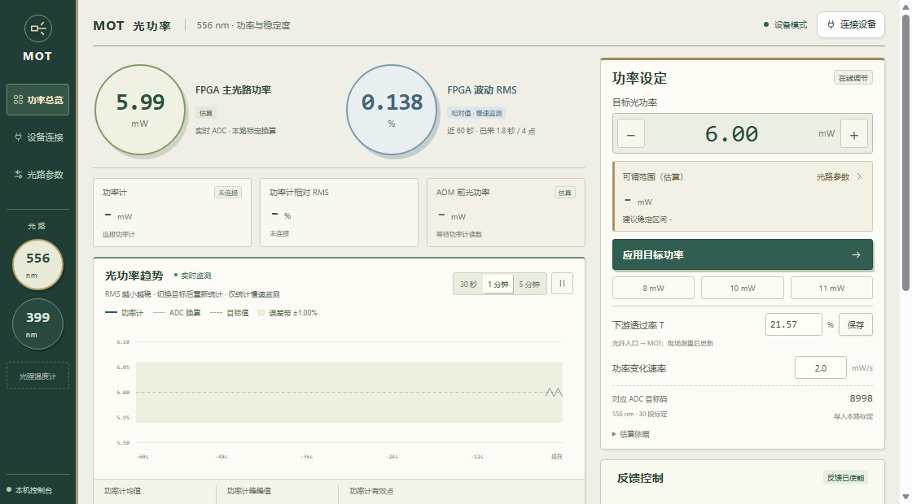
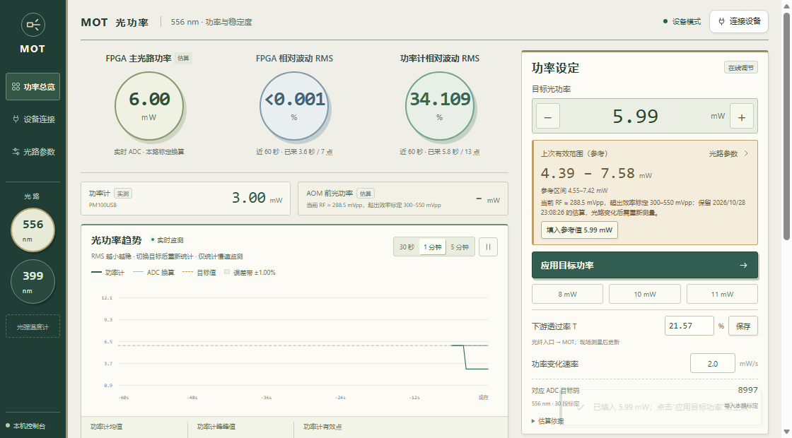

# 20261026 PID Control Console

556 nm / 399 nm MOT 双通道光功率控制台。This application runs locally to communicate with laboratory instruments.

Windows 下双击项目目录中的 `start.cmd`，自动检查后台服务后打开 http://127.0.0.1:8766 。首次启动登记当前用户的登录启动任务；之后重复打开会复用已有服务。启动程序不创建桌面快捷方式。网页和仪器通信都在本机运行，不依赖 GitHub 或外网。直接打开 `index.html` 仅能查看界面。

## 光路通道

- **556 nm MOT**：保留已有 30 段标定、目标设定与功率监测。
- **399 nm MOT**：独立目标、曲线、设备连接、效率及透过率；功率计按 399 nm 设定并回读。目标初始未设，效率参数与标定初始未知。
- **光强温度计**：预留入口，暂未接入仪器或测量协议。

先选通道，再连接该路的 FPGA 和功率计。当前两路各使用独立串口控制器，单路控制器不会因切换界面而改接另一光路。同一串口或功率计不能同时分配给两路；只有一个功率计时，先断开原通道再连接另一通道。

399 nm 的目标可先保存；向 FPGA 应用目标前须点击“导入本路标定”，载入 399 nm 的真实标定。JSON 使用 `wavelength_nm: 399`、`encoding: "pi_unsigned_14"` 和 `points`（至少两个真实的 `power_mw` / `adc_code` 单调节点）。556 nm 标定不能直接用于 399 nm。文件结构可参考 `data/calibration.json`，节点须来自本路测量。没有本路标定时 ADC 换算值显示 `-`，不下发未经标定的功率目标。

## 使用

1. 输入目标光功率（mW），可先保存设定。连接 FPGA 后点击“应用目标功率”，通过原有 30 段标定换算 ADC 目标码，并按设置的变化速率更新。每次写入目标后读回校验，不需要重新烧录。
2. 点“连接设备”，选择本路 FPGA 串口（刷新时自动替换失效的旧编号；只有一个空闲串口时自动选中）；功率计自动扫描，在下拉列表按型号和序列号选择，再点“连接功率计”。只发现一台时自动选中；换表后点“扫描”即可。两路分别记住选择，功率计可独立于 FPGA 连接。
3. 点“效率与透过率”，填写 AOM 出口到功率计位置的总透过率 T。556 nm 的效率及上下限自动计算；399 nm 手动填写。
4. 顶部首行并列显示 FPGA 估算主光路功率、FPGA 相对波动 RMS、功率计相对波动 RMS，两路 RMS 等字号。FPGA 功率来自本路实时 ADC 与标定换算，不依赖光功率计；功率计实测功率放在下方小卡片。未连接或数据过期时对应字段显示 `-`。AOM 入射功率和范围估算仍需要有效功率计数据。

## 计算

- AOM 前功率 = 功率计读数 ÷ (η × T)。T 未知可留空，显示“等效入射功率”=功率计读数÷η，并标注未校正下游损耗；该值等于 P_in×T，不是 AOM 前的实际功率。
- 预计功率下限 = 功率计读数 × 最小效率 ÷ η。
- 预计功率上限 = 功率计读数 × 最大效率 ÷ η。
- 默认在理论范围两端各预留总跨度的 5%，作为建议范围。

η 是双程总效率，不再平方。界面参数使用百分数。556 nm 使用实测曲线随 DAC 自动更新；399 nm 改变 RF 后应更新手填效率。T 不默认按 100% 计算。范围估算要求下游耦合稳定。

当前使用 mW 表示光功率；尚无光束面积，未换算为 mW/cm²。

## 设备与标定

- FPGA：复用已有 C5 定长帧协议，UART 115200 / 8N1。核对固件 ID A623 / A624 或 5030，并核对 D216 修订号。连接只读状态，不自动改目标、PI 增益、方向或通道。
- 功率计：Thorlabs PM100USB / PM100D，使用已有 TLPMX 64 位适配器，连接后按当前通道设定并回读 556 nm 或 399 nm。需本机安装 Thorlabs 驱动，路径为 `C:/Program Files/IVI Foundation/VISA/Win64/Bin/TLPMX_64.dll`。
- 依赖：Python 3.10+，Edge / Chrome。pySerial 3.5 已随包提供；无需为界面安装其他 Python 包。
- 历史标定：实际 2026-10-20 的 30 段 / 31 节点，已将原 C 码转换为 PI 内部码 `y = 16383 - C`；禁止超出标定范围外推。使用前核对当前分光比例、PD 增益和通道。
- 停用 PI 不等于关闭 RF 或关光。退出或断开时停止继续下发软件斜坡，保留板上最后状态。
- 电脑仅做设定和慢速监测，功率计不进入高速 PI 环；界面 RMS 是慢速监测统计。

## 验证

运行 `python -m unittest discover -s tests -v` 可重测设备与通道隔离，运行 `node tests/test_optics.cjs` 与 `node tests/test_stability.cjs` 可重测光路估算和 RMS；这些自动测试不访问真实仪器。最新真实 Edge 检查覆盖独立归一化、目标切换重计数、断连、通道切换、五种窗口尺寸及实际鼠标点击。浏览器隔离测试与真实设备状态分别记录于 docs/20261028-notebook-ui-check.json；先前实机连接和采样证据另见 docs 中对应记录。

检查包完整性可运行 `python server.py --check`。Windows 日常使用请走 项目目录中的 `start.cmd`，由后台任务维护可用性。手动运行 `python server.py --port 8767 --open` 仍可用于调试；手动服务依赖该进程，端口已被占用时会明确报错。

服务仅监听 127.0.0.1，启动不自动访问仪器。光路参数和每路选择的功率计序列号保存在本机浏览器中；刷新后从运行中的服务读取当前状态，服务重启后需重新连接设备。

## 界面预览

界面预览记录了 2026-10-28 截图时的实机读数，数值会随现场状态更新；556 nm 与 399 nm 共用此布局并保持各自的参数和统计。

从单通道版本升级时，请关闭原控制台命令窗口，再重新运行 start.cmd；新版界面会拒绝使用尚未重启的旧设备服务。

## 2026-10-28：556 nm 自动效率估算

556 nm 使用已确认的通道 8 参数：100 MHz、A=0.226+0.0087V。GUI 幅度为峰值参数，实际峰值=设置值×0.77，因此 RF[mVpp]=2000×0.77×A；DAC 电压 V=(D−8198)×0.0006533。使用 2026-10-21 的 300–550 mVpp / 251 点原始效率表插值，数据在 data/556-double-pass.csv。估算要求映射、RF 链路与光路条件仍适用。

效率随 FPGA 实时 DAC 更新；功率范围取实际 DAC 限幅与标定区间的交集，并检查区间内所有效率节点的极值，包含非单调段。超出标定部分不外推，界面明确标为部分范围。无有效 DAC 或功率计读数时不显示实时范围。当前 RF 超出效率标定时，如有同一设备与参数条件下的有效记录，显示带时间标记的历史范围参考；没有记录则直接提示标定边界及恢复方向。AOM 入射功率仍需要实际下游总透过率 T；T 未知时显示 P/η，并明确标注“等效入射功率 / 未校正”；填写真实 T 后才显示 AOM 前功率 P/(ηT)。

串口按当前 Windows 枚举结果选择，连接成功后按通道记住实际端口；功率计按当前 USB 扫描结果选择，不绑定固定序列号。板上目标的 mW 显示来自 ADC 历史标定，尚不能据此认定当前光路标定已验收。UI 更新不写 FPGA、DDS 或 Flash。

实机验证：2026-10-28 恢复 A624 RAM 固件与 C07 参数，当前工作点重测目标 ADC 8479。目标小幅往返时，实测均值约 1.54422 → 1.48606 → 1.54476 mW，最终恢复原目标码；本次验证控制响应，不宣称绝对功率误差已达 ±1%。详见 docs/20261028-live-check.json。Flash 未写，掉电后需恢复 RAM 固件与参数。

可调范围已移至目标输入框下面，底部范围卡片已删除。P_current=P_in×η_current×T，因此同一光路、入射功率和下游透过率保持不变时，P_limits=P_current×η_limits/η_current，不需要单独知道 T。该范围仍要求当前效率可由标定得到；当前 RF 超出300–550 mVpp时，明确显示原因，不使用过期读数或未经标注的外推值。

## 每次使用前更新下游透过率

用户 2026-10-28 提供：AOM 后光纤入口 23 mW、最终 MOT 位置 4.96 mW，入口至 MOT 总透过率为 4.96/23=21.565217…%。556 nm 默认采用此值，已有浏览器在本次更新后首次打开时也载入一次，后续用户保存值不会被覆盖；399 nm 独立保存，默认未知。若 AOM 双程出口到光纤入口还有未计入损耗，应将它计入总透过率，才能得到相应的 AOM 前绝对功率。

在目标功率旁的“下游透过率 T”输入本次实测百分数并点击“保存”或按 Enter。仅更新功率估算和浏览器本地参数，不下发 FPGA 目标或改变 PI。允许大于0且不超过100%；留空保存恢复未校正的等效功率显示。AOM 双程衍射效率仍由 DAC 与标定独立计算；透过率不替代衍射效率。光路参数弹窗与快捷输入共享同一数值。

## PM100D / PM100USB 切换

两种型号共用厂商 TLPMX 驱动。设备窗口列出当前 USB 功率计的实际型号和序列号，扫描只枚举设备，不打开或重置仪器。连接时按当前光路设定并核对波长，同时设置并核对 W 单位，读数统一换算为 mW。旧 PM100D（M01306624）与 PM100USB（P2007293）均通过同一适配器连接；更换仪器后无需改代码或手输序列号。若同时插入多台，按序列号选择；被另一光路使用的仪器会标注并禁选。断开后实测值及依赖它的估算显示“-”。

## 2026-10-28：双型号功率计与数码管实时显示

PM100USB P2007293 已通过真实 Edge 界面完成扫描、连接、断开和重新连接，波长 556 nm、W 单位均读回核对，网页持续显示 mW 读数。PM100D 使用相同适配器；11 项自动测试覆盖两种型号、波长、单位换算、设备独占以及旧表拔出后不得误连新表。旧 PM100D 本次未同时接入，沿用此前实机使用记录。

数码管改为每 0.1 秒取一个 ADC 实时采样点，经原 30 段标定显示功率，不做长时间平均。固件源码、验证后的 bitstream 及说明位于 firmware/instant-display。当前已加载 RAM，并恢复加载前的目标、PI 增益与输出限幅；没有写入 Flash，因此掉电后需要重新加载。重载产生的 ADC 过量程历史标志仍如实显示，四轮新的采样验证没有实时过量程或冻结。详细证据见 docs/20261028-meter-and-display-check.json。

## 功率与稳定度

首行并列显示 FPGA 估算主光路功率、FPGA 相对波动 RMS、功率计相对波动 RMS。两路 RMS 以相同大小的圆形读数显示，分别评估自身稳定度。功率读数使用当前采样，不为了稳定显示而取平均。功率计实测值保留为小卡片，未连接时该读数及顶部功率计 RMS 均为“-”。

这里的相对波动 RMS = sqrt[Σ(P_i − P_mean)² / N] / P_mean × 100%，即相对于各自均值的波动标准差百分比。分母是该路有效数据的均值，不是目标值；FPGA 与功率计分别计算。两路平均读数有偏差时，也能各自评估稳定性。值越小表示当前采样窗口内波动越小；例如均值 10 mW、波动 RMS 0.01 mW 时为 0.1%。

使用曲线的 30 秒 / 1 分钟 / 5 分钟窗口，标明已采时长和有效点数。实际目标变化和斜坡切换后重新统计，设备重连、换表或数据中断只重置受影响的来源，避免把旧工作点和重复轮询计入新的稳定度。少于两个样本或均值不大于零时显示“-”。暂停曲线不暂停顶部实时读数或 RMS。统计只覆盖网页收到的慢速监测点，不代表高速闭环全带宽噪声。

## 2026-10-28：科研控制台界面

采用深绿窄侧栏、暖白面板、低饱和度的圆形读数和细线边框。556 / 399 nm 仍从左侧选择，目标、估算范围和应用按钮保留在首屏；设备连接和光路参数窗口使用同一套样式。样式在本地提供，不依赖外部字体、图片或网络资源。界面改版没有改变 FPGA 控制参数、硬件通信协议或标定数据。

两路 RMS 首行位置补验：真实 Edge 在四种桌面视口下核对 FPGA 功率和两路 RMS 同行、两路 RMS 等字号且不小于26px，目标/范围/应用仍在首屏；另检查手机布局。公式、独立归一化、目标切换重计数和断连行为复验通过。测试数据与真实未连接状态分别记录于 docs/20261028-rms-top-row-check.json，未向硬件下发设置。

## 串口变号与超出效率标定后的恢复

USB 重新插拔后，Windows 可能更换串口编号。刷新和连接前都会重新枚举串口：旧编号不存在且只有一个空闲端口时自动选中它；有多个候选时需要选择，不轮流向其他设备发送命令。已分配给另一光路的串口不作为自动候选。连接成功后以设备服务读回的端口为准，按通道保存；已连接的端口显示锁定，失败连接不会覆盖上次成功记录。本次实机从旧 COM8 改为 COM9 后连接成功，固件读回 A623；没有改写控制目标或 PI 参数。

556 nm 的 RF 效率标定覆盖 300–550 mVpp，实际估算还取与板上 DAC 限幅的交集。工作点落在标定之外，不等于该功率无法稳定，只表示当前效率没有可用标定。因此部分覆盖时页面明确写“已标定可调范围”。

每次取得有效功率和效率后，保留最后一次有效估算；目标斜坡期间不更新该参考。当前 RF 超出标定时继续显示“上次有效范围（参考）”、记录时间及不可实时估算的原因，不外推当前效率。记录按光路隔离，要求功率计、FPGA 端口/固件、DAC 限幅及透过率条件匹配；更改参数或标定会清除旧参考。功率计断连时仍显示“-”。历史参考不能保证光路变化后的当前可达范围。

点击“填入参考值”会把参考区间中值填入目标框，仍需点击“应用目标功率”才下发。输入范围外目标本身不会清空范围。如果没有有效历史记录，界面直接显示 RF 边界及恢复方向；当前映射下低于300mVpp时，可小步提高目标并观察 DAC，回到2710以上的标定区后会自动恢复实时估算。

上图使用浏览器隔离测试数据，展示历史参考的状态，不代表现场功率。11 项真实 Edge 检查覆盖串口变号、多端口选择、失败不记忆、跨通道独占、范围保留、刷新恢复、换表失效、仅填入不下发以及四种窗口首屏布局。最终移除测试数据后核对真实 COM9 与 PM100USB 连接，详见 docs/20261028-port-range-check.json。

## 2026-10-29：本机启动与刷新可靠性

地址 127.0.0.1 是当前电脑。浏览器的 ERR_CONNECTION_REFUSED 表示该端口当时没有接收连接的服务；仅刷新浏览器不能启动 Python。旧入口直接在前台运行 server.py，退出该进程后页面即不可用，重复启动则报端口占用；旧入口没有服务恢复与退出日志。

新入口 `start.ps1` 创建当前用户、普通权限的 Windows 登录任务 `MOT-PID-Control-Console`，运行无控制台窗口的 `launcher.py`，不依赖浏览器或启动它的终端。任务没有默认三天执行时限，允许电池供电，守护进程异常退出时由任务计划重试。项目目录中的 `start.cmd` 调用这个入口，重复打开复用正在运行的 MOT 服务，不创建桌面快捷方式。旧版健康服务也可被接管监测，无需为了更新启动方式打断仪器连接。

守护程序检查本机服务，服务进程退出、端口空闲时重新启动；其他应用占用端口时不杀进程或接管端口。它不因仪器读数慢而重启服务。新增 `/api/health` 不等待串口或 VISA 读数。启动及自动恢复均不连接仪器、不下发目标或 PI 参数；若服务确实重启，重新在“连接设备”中连接仪器，板上运行状态不会因网页服务启动而被重设。普通浏览器刷新会继续使用既有连接。

日志位于 `%LOCALAPPDATA%/MOT-PID-Control-Console/8766/`：`launcher.log` 记录启动、复用及进程退出，`server.log` 记录新启动服务的输出与异常。服务仅监听 127.0.0.1。关闭浏览器不会停止本机服务。需要停用后台运行时，可在 Windows 任务计划程序中结束并禁用 `MOT-PID-Control-Console`；再次双击入口前应重新启用任务。

验证：独立端口 18766、无仪器连接，真实 Windows 任务启动后启动命令退出，服务仍持续响应；重复启动保持同一 PID；重复守护进程自动退出；40 次页面/资源/健康请求成功；结束测试服务后 8.72 秒恢复为新 PID，未自动连接硬件。正式 8766 服务直接复用旧实例，真实 Edge 连续 6 次加载/强制刷新均显示实际 COM9 的 FPGA 数据，PM100USB 连接保留、零控制写入。登录触发器已读回核对，未为本次验证重启电脑。详见 `docs/20261029-startup-check.json`。

可在 Windows 运行 `python tests/check_windows_startup.py` 重测独立启动与恢复；脚本在端口 18766 和同名测试任务已占用时拒绝运行，完成后清理自己创建的测试任务。正式硬件服务不受该测试影响。
