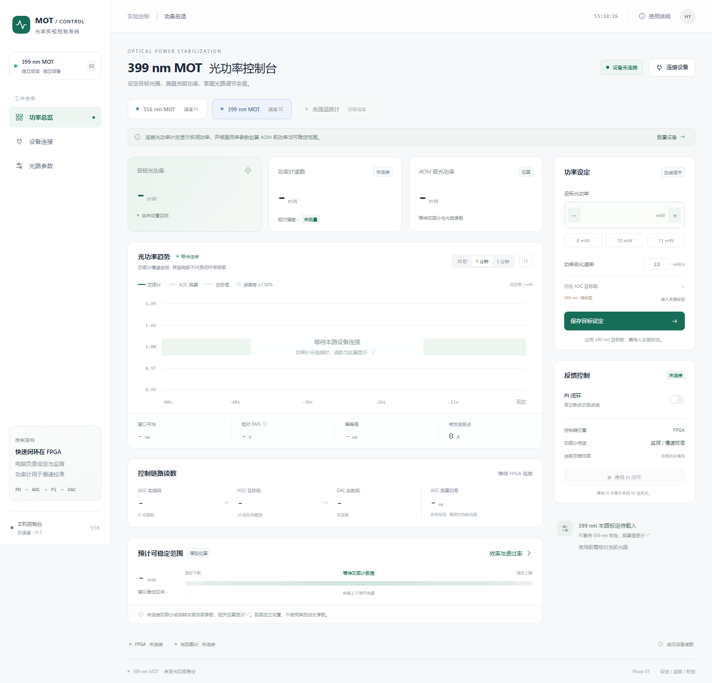

# 20261026 PID Control Console

556 nm / 399 nm MOT 双通道光功率控制台。This application runs locally to communicate with laboratory instruments.

双击 `start.cmd`，打开本机网页 http://127.0.0.1:8766 。也可直接打开 `index.html` 查看界面；真实设备连接需要启动本机服务。

## 光路通道

- **556 nm MOT**：保留已有 30 段标定、目标设定与功率监测。
- **399 nm MOT**：独立目标、曲线、设备连接、效率及透过率；功率计按 399 nm 设定并回读。目标初始未设，效率参数与标定初始未知。
- **光强温度计**：预留入口，暂未接入仪器或测量协议。

先选通道，再连接该路的 FPGA 和功率计。当前两路各使用独立串口控制器，单路控制器不会因切换界面而改接另一光路。同一串口或功率计不能同时分配给两路；只有一个功率计时，先断开原通道再连接另一通道。

399 nm 的目标可先保存；向 FPGA 应用目标前须点击“导入本路标定”，载入 399 nm 的真实标定。JSON 使用 `wavelength_nm: 399`、`encoding: "pi_unsigned_14"` 和 `points`（至少两个真实的 `power_mw` / `adc_code` 单调节点）。556 nm 标定不能直接用于 399 nm。文件结构可参考 `data/calibration.json`，节点须来自本路测量。没有本路标定时 ADC 换算值显示 `-`，不下发未经标定的功率目标。

## 使用

1. 输入目标光功率（mW），可先保存设定。连接 FPGA 后点击“应用目标功率”，通过原有 30 段标定换算 ADC 目标码，并按设置的变化速率更新。每次写入目标后读回校验，不需要重新烧录。
2. 点“连接设备”，填写本路 FPGA 串口和功率计序列号（556 nm 初始 COM9 / P2007293；399 nm 留空，按实际仪器填写）。功率计可独立于 FPGA 连接。
3. 点“效率与透过率”，填写同一工作点的双程效率 η、AOM 出口到功率计位置的下游总透过率 T，以及可调效率上下限。
4. 查看实测功率、AOM 前估计功率和预计可稳定范围。没有功率计或数据过期时，这些数据显示 `-`。即使 FPGA 已连接，也不会用 ADC 换算功率冒充功率计读数。

## 计算

- AOM 前功率 = 功率计读数 ÷ (η × T)。T 未知可留空，AOM 前功率显示 `-`。
- 预计功率下限 = 功率计读数 × 最小效率 ÷ η。
- 预计功率上限 = 功率计读数 × 最大效率 ÷ η。
- 默认在理论范围两端各预留总跨度的 5%，作为建议范围。

η 是双程总效率，不再平方。界面参数使用百分数。初始效率 75.42% 来自用户给定工作点；60%–85% 是待实测确认的范围假设。T 不默认按 100% 计算。改变 RF / DAC 后应更新对应效率，估算要求下游耦合稳定。

当前使用 mW 表示光功率；尚无光束面积，未换算为 mW/cm²。

## 设备与标定

- FPGA：复用已有 C5 定长帧协议，UART 115200 / 8N1。核对固件 ID A623 / A624 或 5030，并核对 D216 修订号。连接只读状态，不自动改目标、PI 增益、方向或通道。
- 功率计：Thorlabs PM100USB / PM100D，使用已有 TLPMX 64 位适配器，连接后按当前通道设定并回读 556 nm 或 399 nm。需本机安装 Thorlabs 驱动，路径为 `C:/Program Files/IVI Foundation/VISA/Win64/Bin/TLPMX_64.dll`。
- 依赖：Python 3.10+，Edge / Chrome。pySerial 3.5 已随包提供；无需为界面安装其他 Python 包。
- 历史标定：实际 2026-10-20 的 30 段 / 31 节点，已将原 C 码转换为 PI 内部码 `y = 16383 - C`；禁止超出标定范围外推。使用前核对当前分光比例、PD 增益和通道。
- 停用 PI 不等于关闭 RF 或关光。退出或断开时停止继续下发软件斜坡，保留板上最后状态。
- 电脑仅做设定和慢速监测，功率计不进入高速 PI 环；界面 RMS 是慢速监测统计。

## 验证

本次在真实 Edge 浏览器中完成 16 项多通道/接口检查，覆盖目标、设备信息、参数、标定、功率计算与断连状态隔离、错误波长标定拒绝及桌面/手机布局。另有 5 项设备/状态隔离测试。运行 `python -m unittest discover -s tests -v` 可重测，不会访问真实仪器。功率计算检查使用隔离的测试响应，没有连接真实实验仪器。设备接口依据现有源码实现，仍需接上仪器验收。

检查包完整性可运行 `python server.py --check`。端口占用时程序明确报错；需要时用 `python server.py --port 8767 --open` 更换端口。

服务仅监听 127.0.0.1，启动不自动访问仪器。光路参数保存在本机浏览器中；刷新后不恢复设备连接或旧测量值。

## 界面预览

